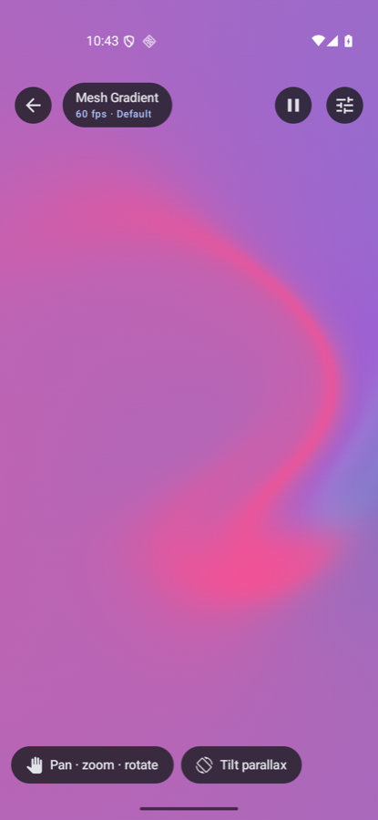
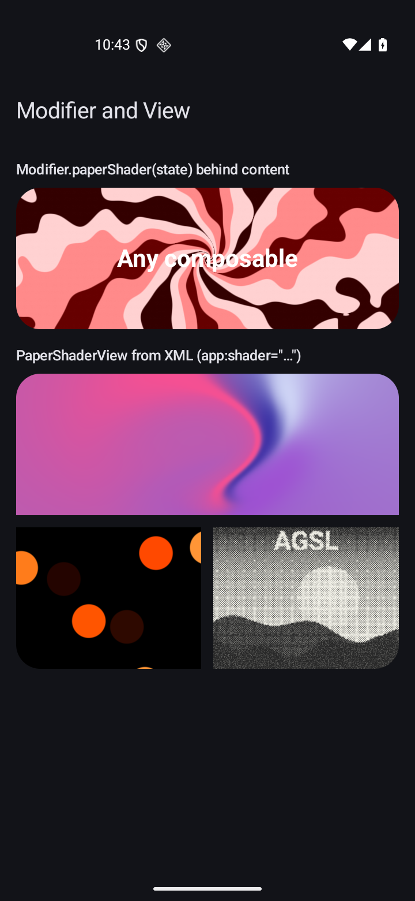
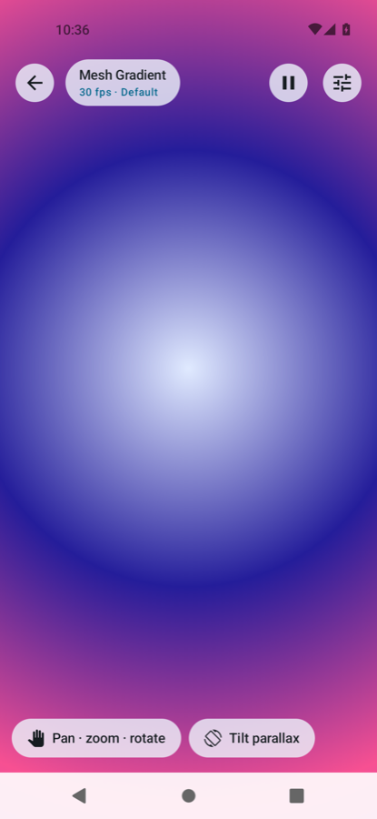

# Paper Shaders for Android

GPU shaders for Jetpack Compose and Android Views: an AGSL port of all 30 shaders from
[Paper Shaders](https://shaders.paper.design) ([paper-design/shaders](https://github.com/paper-design/shaders)),
plus three original touch-and-tilt shaders. Mesh gradients, warps, grain, dithering, halftones,
liquid metal and more, each with Paper's presets and every parameter editable live.

<p>
  
  
  
</p>

- **Compose:** `PaperShader(state)`, or `Modifier.paperShader(state)` behind any content.
- **Views:** `PaperShaderView` with `app:paperShader="mesh-gradient"` in XML.
- **Fast:** uniforms upload only after an edit or a resize, and each frame writes one float
  (`u_time`). Edits and animation redraw without recomposing.
- **API 24 and up:** AGSL needs Android 13 (API 33). Below that, every shader draws a static
  gradient of its own colors (image shaders show the image), so the same code runs everywhere.

> **Credit:** the shader designs, math and presets are by [Paper](https://paper.design), licensed
> Apache-2.0. This project ports them to AGSL and Kotlin. It is not affiliated with or endorsed by
> Paper. See [NOTICE](NOTICE).

## Install

The library is published through [JitPack](https://jitpack.io/#WarrenAdams8/paper-shaders-android).

```kotlin
// settings.gradle.kts
dependencyResolutionManagement {
    repositories {
        google()
        mavenCentral()
        maven("https://jitpack.io")
    }
}
```

```kotlin
// app/build.gradle.kts
dependencies {
    implementation("com.github.WarrenAdams8:paper-shaders-android:0.1.1")
}
```

Requirements: `minSdk` 24 or higher, Kotlin 2.x. The library exposes `compose-ui`,
`compose-foundation` and `compose-runtime` (Compose BOM 2026.03). Views-only apps work too: `PaperShaderView` uses the
Compose runtime for its state, not for drawing.

## Quick start (Compose)

```kotlin
import com.paperdesign.shaders.PaperShader
import com.paperdesign.shaders.rememberShaderState
import com.paperdesign.shaders.specs.MeshGradientSpec

@Composable
fun Background() {
    val state = rememberShaderState(MeshGradientSpec)
    PaperShader(state, Modifier.fillMaxSize())
}
```

Behind content, as a modifier:

```kotlin
val state = rememberShaderState(ShaderCatalog.require("warp"))
Box(
    Modifier
        .fillMaxWidth()
        .height(240.dp)
        .clip(RoundedCornerShape(28.dp))
        .paperShader(state),
    contentAlignment = Alignment.Center,
) {
    Text("Hello", color = Color.White)
}
```

## Choosing a shader and preset

Every shader is a `ShaderSpec` in `ShaderCatalog`. Look one up by id, or use the spec object
directly (`WarpSpec`, `MeshGradientSpec`, ...). The ids, parameters and presets of all 33 shaders
are listed in **[docs/SHADERS.md](docs/SHADERS.md)**.

```kotlin
val spec = ShaderCatalog.require("liquid-metal")   // throws, listing the valid ids, if misspelled
val state = rememberShaderState(spec, spec.preset("Noir") ?: spec.defaultPreset)

state.applyPreset("Stripes")                       // switch presets later
```

## Editing parameters

`ShaderState` holds the live values. Edits are cheap (no recomposition), so you can drive them
from sliders, animations or gestures.

```kotlin
state.set("distortion", 0.6f)                      // any Number works for numeric params
state.set("shape", "stripes")                      // enum params take one of their options
state.set("colors", listOf(Color(0xFF121212), Color(0xFF9470FF)))  // Compose Color or ArgbColor
state.set("speed", 0.5f)                           // common params: speed, frame, scale, rotation, fit...

val d = state.float("distortion")
```

`set` checks the key and the value. A typo or a wrong type throws `IllegalArgumentException`
naming the valid keys, instead of silently rendering a default.

## Images

Image shaders (`fluted-glass`, `halftone-dots`, `halftone-cmyk`, `image-dithering`,
`lens-distortion`, `paper-texture`, `water`, `heatmap`, `gem-smoke`, `liquid-metal`) start with a
bundled sample. Give them your own bitmap:

```kotlin
state.image = myBitmap
```

Use a software bitmap (not `Bitmap.Config.HARDWARE`). Heatmap, Gem Smoke and Liquid Metal
preprocess the image on a background thread and cache the result.

## Playback

```kotlin
PaperShader(state, modifier, playing = false)      // freeze (thumbnails, pause buttons)

val clock = remember { ShaderClock() }             // share or scrub time yourself
PaperShader(state, modifier, clock = clock)
clock.timeMs = 3_000f
```

`speed` scales time, and `0` stops the frame loop. Below API 33 there is no frame loop at all.

## Touch and tilt

`ShaderInput` feeds pointer, tap and gravity data to the shaders that read it (`ripple-pond`,
`gravity-goo`, `flow-lines`), and adds tilt parallax to any shader.

```kotlin
val input = remember { ShaderInput() }
TiltSensorEffect(input, enabled = true)            // runs the gravity sensor only while enabled
PaperShader(
    state,
    Modifier.fillMaxSize().pointerInput(Unit) {
        awaitEachGesture {
            val down = awaitFirstDown()
            input.pointerDown(down.position.x, down.position.y)
            do {
                val event = awaitPointerEvent()
                event.changes.firstOrNull()?.let { input.pointerMove(it.position.x, it.position.y) }
            } while (event.changes.any { it.pressed })
            input.pointerUp()
        }
    },
    input = input,
)
input.parallax = 0.3f                              // tilt-driven offset, for any shader
```

## Views and XML

```xml
<com.paperdesign.shaders.view.PaperShaderView
    android:layout_width="match_parent"
    android:layout_height="240dp"
    app:paperShader="mesh-gradient"
    app:paperPlaying="true" />
```

```kotlin
val view = findViewById<PaperShaderView>(R.id.shader)
view.setShader("warp")                 // or view.state = ShaderState(WarpSpec, WarpSpec.presets[2])
view.state.set("speed", 0.5f)          // the view redraws on its own
view.isPlaying = false
```

The view compiles shaders on a background thread, and stops its frame loop while hidden or
detached.

## Performance notes

- A `ShaderSpec` compiles once per composable (`remember(spec)`). Keep the same `ShaderState`
  rather than creating a new one on every recomposition.
- Full-screen Liquid Metal and Gem Smoke, or any shader at a high `scale`, can be heavy on
  low-end GPUs. The sample app's `benchmark` build type shows real frame rates.
- A paused shader (`playing = false` or `speed = 0`) draws once and then costs nothing.

## The Warp-only API

The first version of this project ported only Warp, with its own typed API. It is still included
in `com.paperdesign.warp`: `Warp(params = WarpPresets.Default)`, `Modifier.warp(...)`, `WarpView`,
`WarpParams` and `WarpPresets` (`Default`, `CauldronPot`, `LiveInk`, `Kelp`, `Nectar`, `Passion`).
New code should prefer `PaperShader` with `WarpSpec`, which matches upstream exactly and supports
the shared sizing params.

## How the port works

| Upstream (WebGL2) | Android (AGSL) |
|---|---|
| Vertex shader computes object, pattern and image UVs | `PaperSizing` runs the same math on the CPU and sends each UV as two affine rows |
| `u_noiseTexture` (128x128 PNG) | `res/drawable-nodpi/paper_noise.png`, bound as a shader input with CLAMP and bilinear filtering |
| `texture(u_image, uv)` | `paper_image(uv)` = `u_image.eval(uv * size)` |
| `fwidth`, `dFdx`, `dFdy` (not in AGSL) | Exact affine derivatives, analytic gradients, or forward differences; each site is commented in its `.agsl` file |
| `%`, array constructors, dynamic indexing, `round`, `transpose`, `bool` uniforms | `mod`, arithmetic tables, loop lookups, `floor(x + .5)`, inverse rotation, float uniforms |
| JS image preprocessing (heatmap blur, Poisson roundness) | `ImageProcessing.kt`, run on `Dispatchers.Default` and cached |

## Repository layout

```
paper-shaders/                       the library (com.paperdesign.shaders, com.paperdesign.warp)
  src/main/assets/shaders/*.agsl     shader bodies (ported fragment shaders)
  src/main/kotlin/.../shaders/       PaperShader, ShaderState, ShaderSpec, ShaderInput, view/PaperShaderView
  src/main/kotlin/.../shaders/specs/ one spec per shader, plus ShaderCatalog
  src/test, src/androidTest          unit tests; on-device compile and render tests
app/                                 sample gallery app: every shader, presets, live controls
docs/SHADERS.md                      generated shader reference
AGENTS.md                            guide for coding agents working on or with this library
```

## Building and testing

```bash
./gradlew :paper-shaders:testDebugUnitTest            # unit tests (catalog, state, sizing, docs drift)
./gradlew :paper-shaders:connectedDebugAndroidTest    # on a device: compile and render every preset
./gradlew :paper-shaders:lintDebug :app:lintDebug
./gradlew :app:installDebug                           # the sample gallery
./gradlew :paper-shaders:publishToMavenLocal          # try the artifact locally
```

Open a shader in the sample directly:
`adb shell am start -n com.paperdesign.warp/com.example.warpshader.MainActivity --es shader warp`

## License

Apache License 2.0, see [LICENSE](LICENSE). Shader designs and presets come from
[paper-design/shaders](https://github.com/paper-design/shaders) (Apache-2.0); see [NOTICE](NOTICE).
